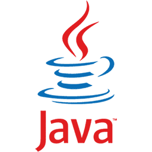
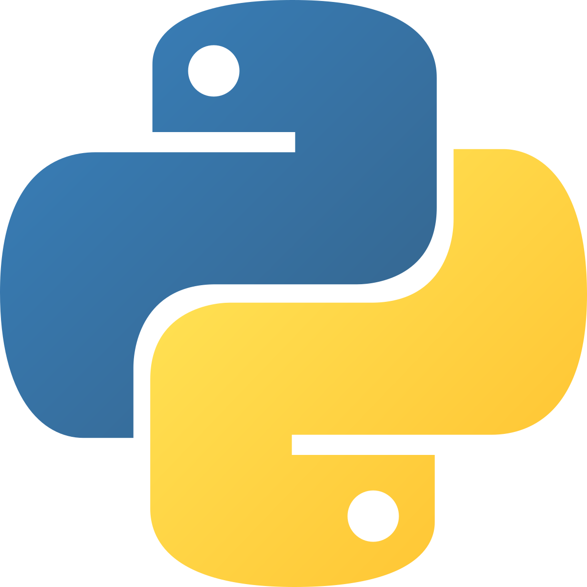
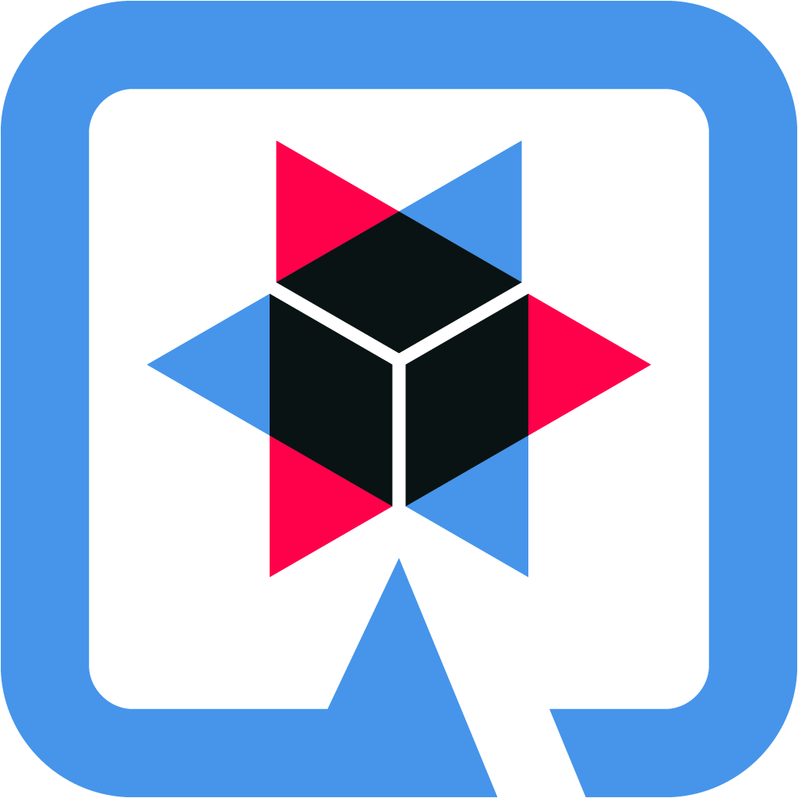
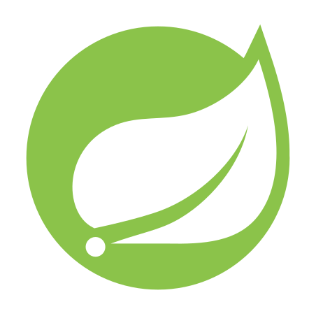
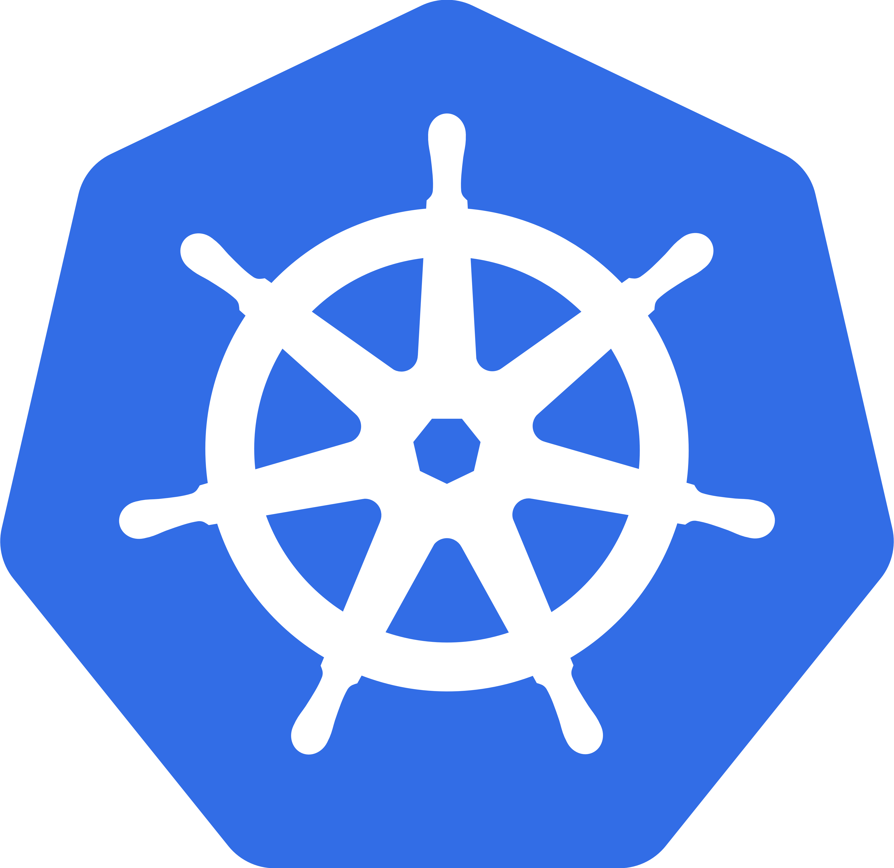
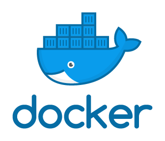
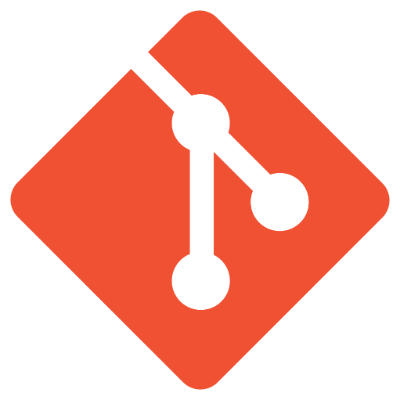
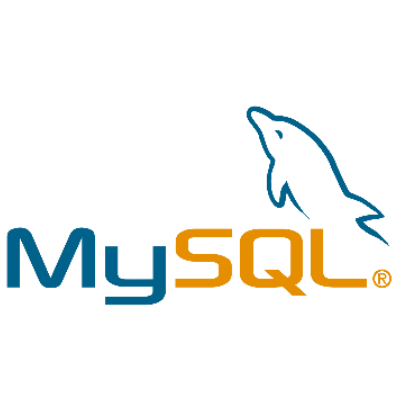
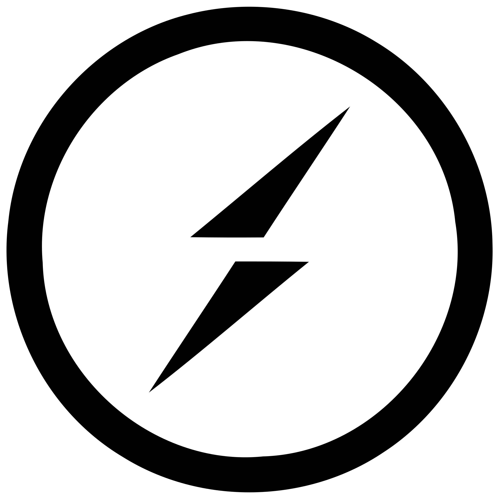

### Hi there, I am Dimitris 

I am a passionate software engineer from Athens, Greece. Τhrough my working experience and personal experimentation, I aim at developing a comprehensive overall understanding, while keeping up with new trends in software architecture, automation and technologies.

**You can reach me at** 

&nbsp;

&nbsp;
**or email me at** 
<a href="mailto:webmaster@example.com">
  dfotiou.tech@gmail.com📫
</a>

 

**Usually messing with various...**

*languages:*
&nbsp;
<code></code>
<code></code>
<code></code>
<code></code>
<code></code>

*frameworks:*
&nbsp;
<code></code>
<code></code>
<code></code>
<code></code>

*technologies and tools:*
&nbsp;
<code></code>
<code></code>
<code></code>
<code></code>
<code></code>
<code></code>
<code></code>
<code></code>
<code></code>

 
